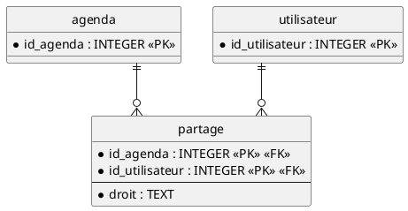

# Conception — Partage d'agendas (#92)

Le but : qu'un utilisateur puisse partager un de ses agendas avec quelqu'un d'autre, soit en lecture (il voit les activités), soit en écriture (il peut aussi les créer, les modifier et les supprimer). L'agenda partagé apparaît chez le destinataire avec le droit qu'on lui a donné. Seul le propriétaire de l'agenda décide qui a accès.

## La table partage

C'est une table de liaison entre `agenda` et `utilisateur` : une ligne signifie « cette personne a ce droit sur cet agenda ». Le propriétaire n'y figure pas, puisqu'il a déjà tous les droits sur ses propres agendas.



| Colonne | Rôle |
|---|---|
| `id_agenda` | L'agenda partagé. Si on supprime l'agenda, ses partages disparaissent (`ON DELETE CASCADE`). |
| `id_utilisateur` | La personne avec qui on partage. Idem si on supprime le compte. |
| `droit` | `'lecture'` ou `'ecriture'` (contrôlé par un `CHECK`). |

La clé primaire est le couple `(id_agenda, id_utilisateur)`. Du coup on ne peut jamais avoir deux lignes pour le même agenda et la même personne : pas de doublon possible.

Migration `database/migrations/006_creer_table_partage.sql` :

```sql
CREATE TABLE IF NOT EXISTS partage (
    id_agenda INTEGER NOT NULL REFERENCES agenda(id_agenda) ON DELETE CASCADE,
    id_utilisateur INTEGER NOT NULL REFERENCES utilisateur(id_utilisateur) ON DELETE CASCADE,
    droit TEXT NOT NULL CHECK (droit IN ('lecture', 'ecriture')),
    PRIMARY KEY (id_agenda, id_utilisateur)
);
```

## Savoir ce qu'un utilisateur a le droit de voir

C'est la seule partie un peu délicate. Plusieurs endroits ont besoin de la même information : « quels agendas cette personne peut-elle voir, et avec quel droit ? ». La route des agendas en a besoin (pour afficher aussi les agendas partagés), les routes des activités aussi (pour autoriser ou refuser une modification), et la recherche (#94) également. Si on recopie la requête à chaque fois, le jour où la règle change il faut la corriger partout.

On la met donc à un seul endroit, dans un nouveau fichier `server/acces.js`, avec deux fonctions :

- `agendasAccessibles(idUtilisateur)` : renvoie tous les agendas que la personne peut voir — les siens *et* ceux partagés avec elle — chacun avec une colonne `droit` (`'proprietaire'` pour ses propres agendas, sinon `'lecture'` ou `'ecriture'`).
- `droitSurAgenda(idUtilisateur, idAgenda)` : renvoie `'proprietaire'`, `'ecriture'`, `'lecture'`, ou `null` si la personne n'a aucun accès. C'est ce qui sert à vérifier un droit avant de lire ou de modifier des activités.

`agendasAccessibles` est juste l'union des agendas possédés et des agendas partagés :

```sql
SELECT a.*, 'proprietaire' AS droit
FROM agenda a
WHERE a.id_utilisateur = ?
UNION ALL
SELECT a.*, p.droit AS droit
FROM agenda a
JOIN partage p ON p.id_agenda = a.id_agenda
WHERE p.id_utilisateur = ?
ORDER BY nom;
```

Règle des droits, la même partout : un propriétaire peut tout faire, l'écriture permet de lire et de modifier, la lecture permet seulement de lire.

## Les routes de partage

Toutes sous `/api`, réservées aux utilisateurs connectés (comme le reste de l'API). Les partages d'un agenda ne sont visibles et gérables que par son propriétaire ; pour quelqu'un d'autre, on répond `404` (on ne laisse pas deviner que l'agenda existe).

| Méthode | Route | Corps | Réponse |
|---|---|---|---|
| `POST` | `/api/agendas/:idAgenda/partages` | `{ email, droit }` | `201` si c'est un nouveau partage, `200` si on a mis à jour un droit déjà donné |
| `GET` | `/api/agendas/:idAgenda/partages` | — | `200` + la liste des partages de l'agenda |
| `DELETE` | `/api/agendas/:idAgenda/partages/:idUtilisateur` | — | `204` |

Le `DELETE` couvre les deux besoins de l'issue avec une seule route : le propriétaire peut retirer n'importe qui (« annuler un partage »), et une personne peut retirer son propre accès (« se retirer soi-même », quand `:idUtilisateur` est elle-même). Dans les autres cas, `404`.

Pour le `POST`, les refus possibles :

| Situation | Réponse |
|---|---|
| L'agenda n'existe pas, ou on n'y a aucun accès | `404` |
| On a accès à l'agenda mais on n'en est pas le propriétaire | `403` |
| `droit` absent ou autre que `lecture` / `ecriture` | `400` |
| Aucun utilisateur n'a cet email | `404` |
| L'email est celui du propriétaire (partage à soi-même) | `400` |

Si l'agenda est déjà partagé avec cette personne, on ne crée pas de doublon : on remplace simplement son droit (par exemple lecture → écriture) et on répond `200`. C'est ce qui arrive quand on recoche un autre droit dans l'interface.

Un partage renvoyé contient de quoi afficher la personne, jamais son mot de passe :

```json
{
    "idAgenda": 3,
    "idUtilisateur": 7,
    "nom": "Alice",
    "email": "alice@example.com",
    "droit": "lecture"
}
```

## Ce que ça change dans le code déjà écrit

Le partage ne sert à rien si les routes existantes ne le respectent pas. Ces changements font partie de #92.

`GET /api/agendas` doit maintenant renvoyer aussi les agendas partagés : on utilise `agendasAccessibles(...)` au lieu de la requête « mes agendas » actuelle, et chaque agenda renvoyé gagne son champ `droit`, pour que le client sache s'il peut modifier.

Les routes des activités vérifient aujourd'hui « cet agenda m'appartient ». On remplace cette vérification par une vérification de droit :

| Route | Droit nécessaire |
|---|---|
| `GET /api/agendas/:idAgenda/activites` | lecture (ou plus) |
| `POST /api/agendas/:idAgenda/activites` | écriture |
| `PUT /api/activites/:idActivite` | écriture sur l'agenda de l'activité |
| `DELETE /api/activites/:idActivite` | écriture sur l'agenda de l'activité |

Concrètement, l'appel à `getAgendaOfUser(...)` devient un appel à `droitSurAgenda(...)` dont on teste le niveau.

La règle des refus est la même partout : si on n'a **aucun accès** à l'agenda, on répond `404` (on ne révèle pas son existence) ; si on y a accès mais que le **droit est insuffisant** pour l'action (par exemple on est en lecture et on essaie de créer une activité), on répond `403` avec `{ "erreur": "Droit insuffisant" }`. Le client peut ainsi afficher un vrai message « lecture seule » au lieu d'un agenda qui disparaît.

## Lien avec la recherche (#94)

La recherche devra porter sur les agendas de l'utilisateur plus ceux partagés avec lui. Comme cette liste est exactement ce que renvoie `agendasAccessibles(...)`, la route de recherche s'en servira directement et ne réécrira aucune logique d'accès.
